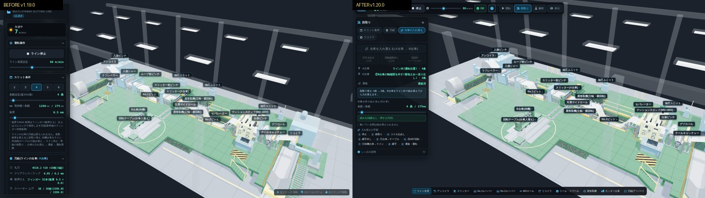
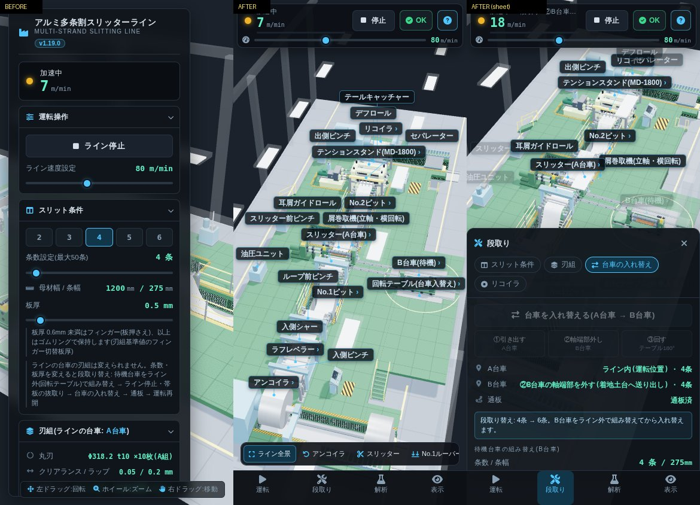

# UI/UX 全面見直し(v1.20.0)— 評価の記録

手順は `CLAUDE.md` の「UI/UX の修正ルール」。採点は 100 点満点
(使いやすさ15 / わかりやすさ15 / 直感性15 / 汎用性15 / 視覚表現15 / 階層構造化10 / メイン表示領域15)。
`ui-cover` は UI が 3D を覆っている割合(`tools/ui-capture/shot.js` の出力。左: 閉じた状態 / 右: 項目を開いた状態)。

## 元の画面(v1.19.0)の問題

- 左に 304px の縦長パネル1枚。13 のグループのうち 8 つが最初から開いていて、縦スクロールが **4,865px(画面 5.4 枚分)**
- よく使う操作(カメラ・表示切替)が下の方の閉じたグループにある。運転状態(上)と計測値(下)が離れている
- 長い説明文(手順・しくみ)が操作の間に挟まり、操作部品を押し下げる
- スマホ(390×844)ではパネルが画面の **74%** を覆い、畳めない
- `ui-cover`: 1600×900 で 18.0%、1280×720 で 22.1%、390×844 で 73.9%

---

## 項目A: 全体レイアウト・情報の階層

### 1回目(5案 + 方向の違う2案)

最初の5案はどれも「画面の端に付くパネル」の発想に寄っていたので、A6(下のドック)と A7(設備に付く操作カード)を足した。

| 案 | 内容 | ui-cover(1600 閉/開 · スマホ開) | 点 |
|---|---|---|---|
| A1 | 左パネルを4分類のタブに分ける | 10.5 / 15.8 · 45.7 | 73 |
| A2 | 左端のアイコンレール + 開閉するフライアウト | 4.8 / 16.8 · 68.6 | **79** |
| A3 | 上バー(状態・運転)+ 右ドロワー + 下のカメラバー | 9.7 / 30.0 · 65.7 | 76 |
| A4 | 左右2枚(左: 操作 / 右: 解析・計測) | 31.5 / 34.4 · 60.0 | 50 |
| A5 | 今のパネルの改良(排他アコーディオン・既定は閉) | 18.0 / 18.0 · 45.7 | 60 |
| A6 | 下のドック(項目を横に並べたカード) | 9.1 / 49.0 · 60.0 | 72 |
| A7 | 設備に付く操作カード + 最小の状態ピル | 2.6 / 12.0 · 57.0 | 75 |

最高 79 点 < 90 → 2回目へ。

### 2回目(エッセンスの再構成4案 + 1回目の上位3案)

抜き出したエッセンス: A2 の「分類ナビ + 閉じられるパネル」、A3 の「運転操作を常に出す」「視点を1クリックで」、
A7 の「設備から設定へ」、A6 の「項目を1つずつ見せる」。

| 案 | 内容 | ui-cover | 点 |
|---|---|---|---|
| B1 | レール + 上の状態バー + フライアウト(アコーディオン) + カメラバー | 14.1 / 26.2 · 65.7 | 80 |
| B2 | B1 + 項目チップ(1つずつ表示) + 分類を開くと設備へカメラが飛ぶ | 14.1 / 23.0 · 57.1 | **85** |
| B3 | 上バー + 右に浮くカード + チップ + カメラバー | 8.9 / 18.0 · 57.1 | 84 |
| B4 | レール + 小さな状態ピル + チップ + 札クリックで項目を開く | 4.4 / 13.4 · 57.0 | 83 |
| A2 / A3 / A7 | (1回目の上位) | | 79 / 76 / 75 |

最高 85 点 < 90 → 3回目へ。残った問題: 横いっぱいの状態バーは空きが多い / ピルに速度がない /
左のフライアウトが上流(アンコイラ側)を隠す / アイコンだけのカメラボタンは分かりにくい / B3 はスマホで「表示」が消える。

### 3回目(再構成4案 + 2回目の上位3案)

新しく入れたエッセンス: **3D の投影中心をパネルの空いた側へずらす**(`camera.setViewOffset`)、
状態・運転・速度を1つの小さなかたまりにまとめる、文字付きのカメラバー、札クリック。

| 案 | 内容 | ui-cover | 点 |
|---|---|---|---|
| C1 | レール + 小さな状態かたまり + 左フライアウト(チップ) + 投影中心ずらし + カメラバー + 札クリック | 9.1 / 18.0 · 57.1 | 89 |
| C2 | 上バー + 右カード(チップ) + 投影中心ずらし + カメラバー + 札クリック | 8.9 / 18.0 · 51.4 | 87 |
| C3 | C1 + カメラはメニュー + 分類を開くと設備へ飛ぶ | 6.0 / 14.9 · 62.9 | 89 |
| **C4** | **状態・運転・速度・分類ボタンを左上の1つのかたまりに。パネルはその真下(チップ)。投影中心ずらし + カメラバー + 札クリック** | 7.7 / 17.3 · 57.1 | **94** |
| B2 / B3 / B4 | (2回目の上位) | | 85 / 84 / 83 |

**決定: C4(94点)**。
主な操作(状態を見る・起動停止・速度・分類を開く)が左上の1か所に集まり、開いた項目がその真下に出るのでマウスの移動が短い。
分類 → 項目(チップ)→ 中身の3段で、一度に見えるのは1項目だけ(縦スクロールがほぼ要らない)。
パネルを開いてもラインは空いた所の真ん中へ移るので隠れない。スマホでは分類が画面下のタブ、パネルが下からのシートになる。

C4 の内訳: 使いやすさ15 / わかりやすさ14 / 直感性14 / 汎用性14 / 視覚表現13 / 階層構造化10 / メイン表示領域14。

---

## 項目B: 補足説明(note)の見せ方

項目A の C4 の上で評価。

### 1回目

最初の5案はどれも「文章を隠す / 出す」の発想だったので、N6(文章を図にする)と N7(状況に応じたヒント1行)を足した。

| 案 | 内容 | 点 |
|---|---|---|
| N1 | 説明ごとに ⓘ + 冒頭の抜粋。押すと開く | 80 |
| N2 | ⓘ にツールチップ(ホバー) | 73(タッチで使いにくい) |
| N3 | 項目ごとに「この項目の説明」1つに畳む | 81 |
| N4 | 1行目だけ見せて「続き」 | 76 |
| N5 | 運転かたまりのヘルプ ON/OFF で全部を出し入れ | 74 |
| N6 | 手順は番号付きの手順図、ルールはチップ(今の状態を強調)。残りの文章は ⓘ | **87** |
| N7 | パネル下にヒント1行 + 説明シート | 73(スマホでシートが 79% を覆う) |

最高 87 点 < 90 → 2回目へ。

### 2回目

| 案 | 内容 | 点 |
|---|---|---|
| NB1 | N6 の図 + 残りの文章は項目の最後に「しくみの説明」1つに畳む(N3) | 90 |
| NB2 | NB1 の手順図も畳む | 86(手順が見えない) |
| NB3 | 手順図を1行の横スクロール + 文章は抜粋行(N1) | 85(はみ出た手順が見えない) |
| **NB4** | **NB1 + 運転かたまりの「?」でガイド(図・説明)を全部出し入れ(N5)** | **92** |
| N6 / N3 / N1 | (1回目の上位) | 87 / 81 / 80 |

**決定: NB4(92点)**。実装では手順図が**いまの工程を光らせる**(済んだ工程は緑)ようにした
(台車の入れ替え・段取り替えは `KX.label`、巻取りコイルの払出しは `st.tChange` から)。
板押さえのルールチップは刃組マスタの切替板厚を読み、今の刃組の側を強調する。

---

## 項目C: 解析の読み出し・判定の見せ方

### 1回目

最初の5案はパネルの中の並べ方だけだったので、M6(運転かたまりの判定バッジ)と M7(3D の設備に判定の札)を足した。

| 案 | 内容 | 点 |
|---|---|---|
| M1 | 判定(注意)を解析の先頭に + 分類ボタンに件数 | 84 |
| M2 | 読み出しを2列のタイルに | 72(長い値が窮屈) |
| M3 | 行の左に状態の点 + 細目の行は「詳細」で畳む | 83 |
| M4 | 図を先に・解析だけパネルを広く | 73 |
| M5 | 項目の中を見出しごとのタブに(反り/垂れ/切断面/条ごと/表示) | **85** |
| M6 | 運転かたまりに判定バッジ(件数・色)→ 押すと一覧 | **85** |
| M7 | 3D の設備の上に判定の札 | 77(設備名の札と重なる) |

最高 85 点(僅差の同点)→ 2回目へ。

### 2回目

| 案 | 内容 | 点 |
|---|---|---|
| MB1 | タブ(M5)+ 点・詳細(M3)+ バッジ(M6) | 89 |
| MB2 | タブ + 点・詳細 + 先頭に畳める判定まとめ(押すとその場所へ) | 91 |
| MB3 | タブ無し + 点・詳細 + バッジ + 先頭に判定を全部 | 80 |
| **MB4** | **MB2 + バッジ + 注意のあるタブに色の点 + どこからでも判定を押すとその項目・タブへ飛ぶ** | **95** |
| M5 / M6 / M1 | (1回目の上位) | 85 / 85 / 84 |

**決定: MB4(95点)**。

---

## 項目D: 縦長の画面(スマホ)での全景

C4 ではスマホの全景が横長の画面用の視点のままで、ラインの一部しか見えなかった。

### 1回目(390×844)

| 案 | 内容 | 点 |
|---|---|---|
| D1 | 同じ向きで遠くから(全体が入る距離) | 68(小さく、札が重なる) |
| D2 | ラインを画面の縦に通す斜め視点 | **87** |
| D3 | 真上からの平面図 | 83 |
| D4 | 急な斜め | 83 |
| D5 | スリッターまわりに寄る | 73(全景にならない) |
| D6 | D5 + ラインのミニマップ(押すと移動) | 80 |
| D7 | D1 + 「横向きにすると大きく」の案内 | 72 |

最高 87 点 < 90 → 2回目へ。

### 2回目

| 案 | 内容 | 点 |
|---|---|---|
| DB1 | D2 を少し見下ろし気味に | 86(シートを開くと上流が隠れる) |
| **DB2** | **D2 + 下のシートを開いている間は引いて、シートの上に全長を入れる** | **91** |
| DB3 | D2 と D3 の中間(かなり見下ろす) | 87 |
| DB4 | DB3 + シートで引く | 84 |
| D2 / D3 / D4 | (1回目の上位) | 87 / 83 / 83 |

**決定: DB2(91点)**。あわせてタッチ操作(2本指のピンチでズーム・移動)を入れた(スマホでズームできなかった)。

---

## 実装後の確認(現物のキャプチャ)

| 画面 | 元(v1.19.0) | v1.20.0 閉 | v1.20.0 項目を開く |
|---|---|---|---|
| 1600×900 | 18.0% | 8.3% | 18.5〜21.9% |
| 1280×720 | 22.1% | 10.1% | 26.0〜31.3% |
| 390×844 | 73.9% | 17.1% | 62.9%(下のシート。閉じれば 17%) |

- パネルの縦スクロール: 4,865px → 1項目ずつなので多くは 1 画面に収まる
- よく使う操作までの手数: 起動停止・速度は 0 クリック(常に表示)、視点は 1 クリック(下の視点バー)、各項目は 2 クリック(分類 → チップ)。設備名の札(›付き)からは 1 クリック
- キーボード: `1`〜`4` で分類、`Esc` で閉じる、`Space` で起動/停止
- 判定バッジ → 一覧 → 押すと該当の項目・タブへ、を確認。解析の先頭のまとめ・タブの点も表示を確認
- 試作で採点した姿と同じになっていることを 1600×900 / 1280×720 / 390×844 で確認
